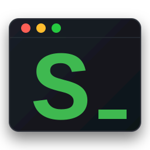

<div align="center">
  
  <h1>Staging</h1>
  <p><strong>Review your coding agent's changes in the browser. Comment inline. Send it back.</strong></p>
</div>

---

A local CLI that opens the staged diff of a git repo in a GitHub-style review UI. You comment, hit **Send**, the agent gets the review. Nothing leaves your machine.

## Install

```bash
git clone https://github.com/barryyosi/staging && cd staging
npm install && npm link
```

## Use

```bash
staging                 # review what is staged
staging --base main     # review the whole branch against main
staging --pr            # review the open pull request
staging notes.md        # preview one markdown / html file
```

## Features

- Inline comments on lines and ranges. Each one reaches the agent once.
- Stage, unstage, revert per hunk. Commit and push.
- Markdown and HTML preview, with comments on the rendered page.
- Review state survives a reopen.
- Switch between sibling repos and worktrees.
- VS Code extension in [`vscode-staging/`](vscode-staging).

## Agent skill

[`use-staging`](skills/use-staging/SKILL.md) tells your agent when to offer a review and how to read it back.

```bash
npx skills add barryyosi/staging -g   # Claude Code, Codex, Cursor, ...

# or, for Claude Code, link your clone so the skill updates with staging
mkdir -p ~/.claude/skills && ln -s "$(npm root -g)/staging/skills/use-staging" ~/.claude/skills/
```

Under the arrow next to **Send to Agent**, switch on **CLI Stdout**: when your agent started `staging`, the review goes straight back to it.

## Config

`~/.stagingrc.json`, overridden by `./.stagingrc.json`.

| Option | Default | |
| :--- | :--- | :--- |
| `sendMediums` | `["clipboard", "file"]` | `cli` prints the review to stdout and exits |
| `reviewFileName` | `.staging-review.md` | |
| `agentCommand` | `code -g {file}:1` | runs after the review file is written |
| `baseBranch` | `null` | |
| `detectPullRequest` | `true` | via `gh`, `glab` or `az` |
| `basePullRequest` | `false` | same as `--pr` |
| `pullRequestProvider` | `null` | `github`, `gitlab`, `azure` |
| `diffContext` | `3` | |
| `port` | `0` | random |
| `autoOpen` | `true` | |
